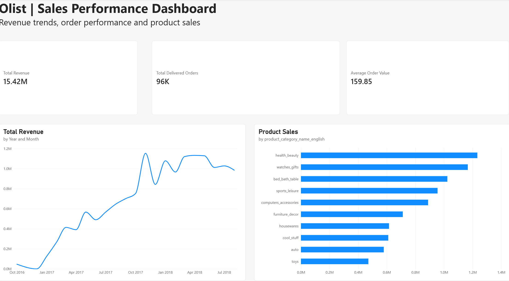
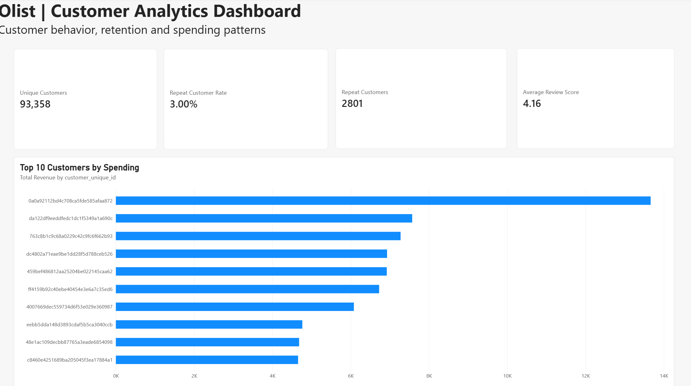
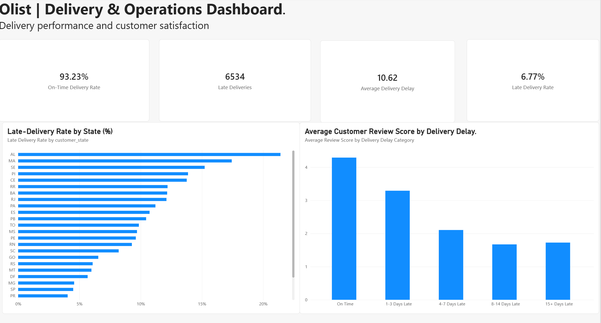

# Olist e-commerce analytics | SQL and Power BI

## Project overview

I used PostgreSQL and Power BI to analyse the Brazilian Olist e-commerce dataset, looking at sales performance, customer purchasing behaviour, delivery operations, and customer satisfaction.

The data came as nine related datasets. I analysed them in SQL and built three interactive Power BI dashboard pages to present what I found.

## Business questions

- How did sales performance change over time?
- Which product categories generated the highest sales?
- How often did customers make repeat purchases?
- Which states and product categories had more delivery delays?
- How were delivery delays associated with customer review scores?

## Tools and dataset

- PostgreSQL and pgAdmin for data preparation, relationships, validation, and SQL analysis
- Power BI for data modelling and interactive dashboards
- DAX for measures on payment value, customer behaviour, and delivery performance
- Power Query for data preparation and data type checks

The data is the [Brazilian E-Commerce Public Dataset by Olist](https://www.kaggle.com/datasets/olistbr/brazilian-ecommerce), available on Kaggle. It has 99,441 orders, along with customers, order items, payments, reviews, products, sellers, geolocation, and product category translations.

## My approach

### 1. Database setup

I imported the nine CSV datasets into PostgreSQL using pgAdmin and set up the table relationships. I then checked for duplicates, missing values, and consistency.

### 2. SQL analysis

I analysed payment values, monthly trends, product categories, customer spending, repeat purchases, and delivery performance, using joins, aggregations, conditional logic, and CTEs to answer the business questions.

Some tables have several records per order, so I kept payment-level and item-level calculations separate. Otherwise the joins would have inflated the totals.

### 3. Power BI dashboards

I connected PostgreSQL to Power BI, reviewed the data types and relationships, and wrote the DAX measures. Then I built three dashboard pages and compared the key Power BI calculations against my SQL results.

## Sales performance

- Total payment value from delivered orders: R$15.42 million
- Delivered orders: 96,478
- Average payment value per delivered order with a payment record: R$159.85
- November 2017 had the highest monthly payment value.
- Health & Beauty was the highest-selling product category among delivered orders.

## Customer analytics

- Unique customers with delivered orders: 93,358
- Repeat customers: 2,801
- Repeat customer rate: 3.00%
- Average customer review score: 4.16/5

Only about 3% of customers with delivered orders bought more than once in this dataset, which makes repeat purchasing a good place to dig further.

## Delivery and operations

- On-time delivery rate: 93.23%
- Late deliveries: 6,534
- Average delay among late deliveries: 10.62 days
- Alagoas had the highest state-level late-delivery rate at 21.41%.
- Rio de Janeiro had 1,495 late deliveries and a late-delivery rate of 12.11%.

### Delivery delays and customer satisfaction

| Delivery status | Average review score |
|---|---:|
| On time | 4.29 |
| 1–3 days late | 3.29 |
| 4–7 days late | 2.11 |
| 8–14 days late | 1.67 |
| 15+ days late | 1.73 |

Late deliveries went with lower average review scores. Scores mostly fell as delays got longer, though the 15+ days group was slightly higher than the 8–14 days group.

## Business recommendations

- Look into delivery bottlenecks. Monitor orders that are getting close to their estimated delivery dates and find the regions with recurring delays.
- Weigh both rate and volume. Rio de Janeiro is worth investigating first because it has an elevated delay rate and a large number of affected orders.
- Test proactive communication. Send earlier updates when a delay is likely, and measure whether that improves the customer experience.
- Look into repeat purchasing. Explore customer engagement and post-purchase experience, and account for how long each customer is observed.
- Track review scores alongside delivery performance when evaluating operational changes.

These recommendations come from historical analysis, and their business impact would need to be tested.

## Methodology and limitations

- One delivered order has no payment record. The delivered-order count includes it, but payment totals and average payment value use the 96,477 delivered orders that have payment records.
- I calculated payment value and product sales separately because payments and order items are recorded at different levels.
- I used `customer_unique_id` to identify customers across orders.
- Repeat purchasing was measured among customers with delivered orders within the observed dataset. It is not a complete measure of long-term retention.
- I measured delivery punctuality by comparing actual and estimated delivery dates at the calendar-date level.
- An order with several product categories may count towards more than one category's delivery statistics.
- Payment value is not necessarily the same as recognised business revenue.
- The data covers historical transactions and does not represent current Olist performance.
- The link between delivery delays and review scores is an association and does not show causation.

## Project files

My SQL scripts, Power BI report, and dashboard screenshots are listed below.

- `sql/` has the table setup, relationships, validation, and the sales, customer, and delivery queries.
- Power BI report: [download the .pbix file](https://github.com/its-adesh/olist-ecommerce-analytics/releases/tag/v1.0). It includes the Sales Performance, Customer Analytics, and Delivery & Operations pages, and opens in Power BI Desktop.
- `screenshots/` has `sales_performance.png`, `customer_analytics.png`, and `delivery_operations.png`.

## Conclusion

This project let me practise relational data analysis, SQL, data modelling, DAX, and dashboard building together. I put most of my effort into explaining what the results mean for sales, customer behaviour, and delivery operations, and into suggesting practical actions a business could test.
